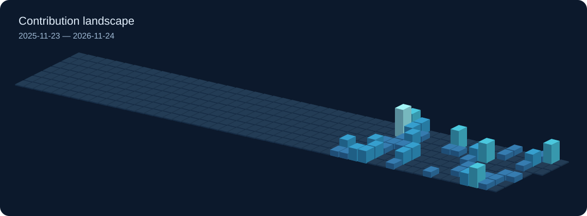

<div align="center">


### Software Engineering & Applied AI at Chitkara University

I build APIs for everyday workflows and explore how retrieval can ground AI answers in source documents.

<a href="https://github.com/Girish9777"></a>
<a href="https://www.linkedin.com/in/girish-bansal-dev/"></a>
<a href="https://leetcode.com/u/GirishAlgo/"></a>
</div>

## `whoami.cpp`

```cpp
#include <array>
#include <string_view>

namespace girish {
    using namespace std::literals;
    constexpr auto university = "Chitkara University, Punjab"sv;
    constexpr std::array toolkit{"C++"sv, "Python"sv, "SQL"sv};
    constexpr auto current_question =
        "Which source supports this answer?"sv;
}
```

## About me

I’m pursuing a B.Tech in Computer Science and Engineering with a specialization in Artificial Intelligence. I’m interested in SDE, backend, and applied AI roles. My current studies connect machine learning and deep learning with two system design questions: how services communicate and how individual classes share responsibility.

## Selected projects

**[JanSeva AI](https://github.com/JanSevaAIHub/Jan_Seva)** · FastAPI, PostgreSQL, pgvector, React  
A civic-assistance team project with two distinct workflows. The scheme navigator retrieves passages to support answers about welfare schemes. The grievance API tracks internal complaints from citizen submission through officer review, with role-based access and an event history.

**Smart Clinic Management System** · Appointment scheduling  
A clinic workflow for managing patients, doctors, appointments, and billing. Scheduling starts with a doctor’s availability and checks for a conflicting booking before accepting an appointment.

**[Expense Tracker](https://github.com/Girish9777/Expense-tracker)** · Python, Flask, SQLAlchemy  
A personal finance web app with account-based balance tracking. The Flask application keeps user records in a SQLAlchemy model and renders the interface with server-side templates.

## Engineering toolkit

<p align="center">
 &nbsp;
 &nbsp;
 &nbsp;
 &nbsp;
 &nbsp;

</p>

**Languages** · C++, Python, SQL, JavaScript  
**Backend & data** · REST APIs, authentication, relational modeling, vector search  
**Applied AI** · Retrieval-augmented generation, embeddings, source attribution

## Algorithms & competitive programming

C++ is my primary language for timed problem solving. My practice spans graph traversal, dynamic programming, binary search, and linked lists.

[Browse my C++ solutions](https://github.com/Girish9777/DSA) · [LeetCode practice](https://leetcode.com/u/GirishAlgo/)

## GitHub activity



<p align="center"><sub>Girish Bansal · Chitkara University, Punjab</sub></p>
